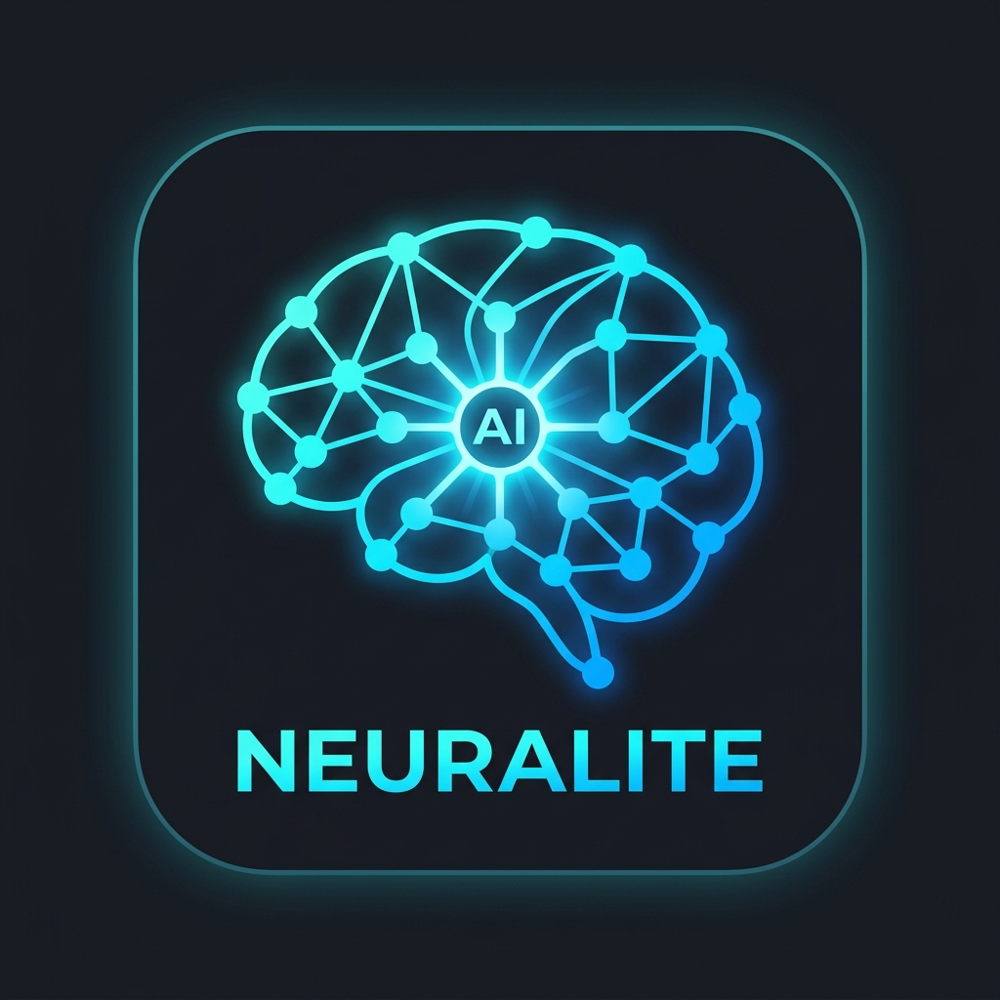
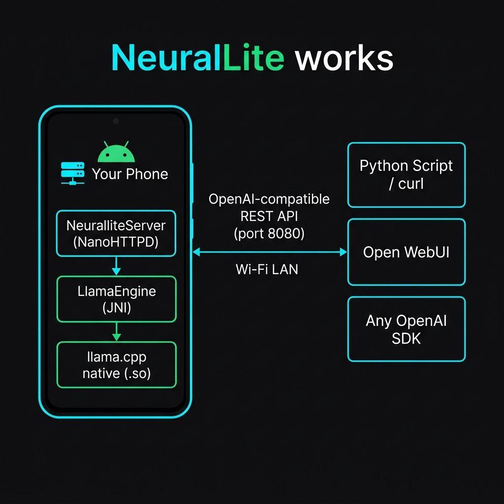
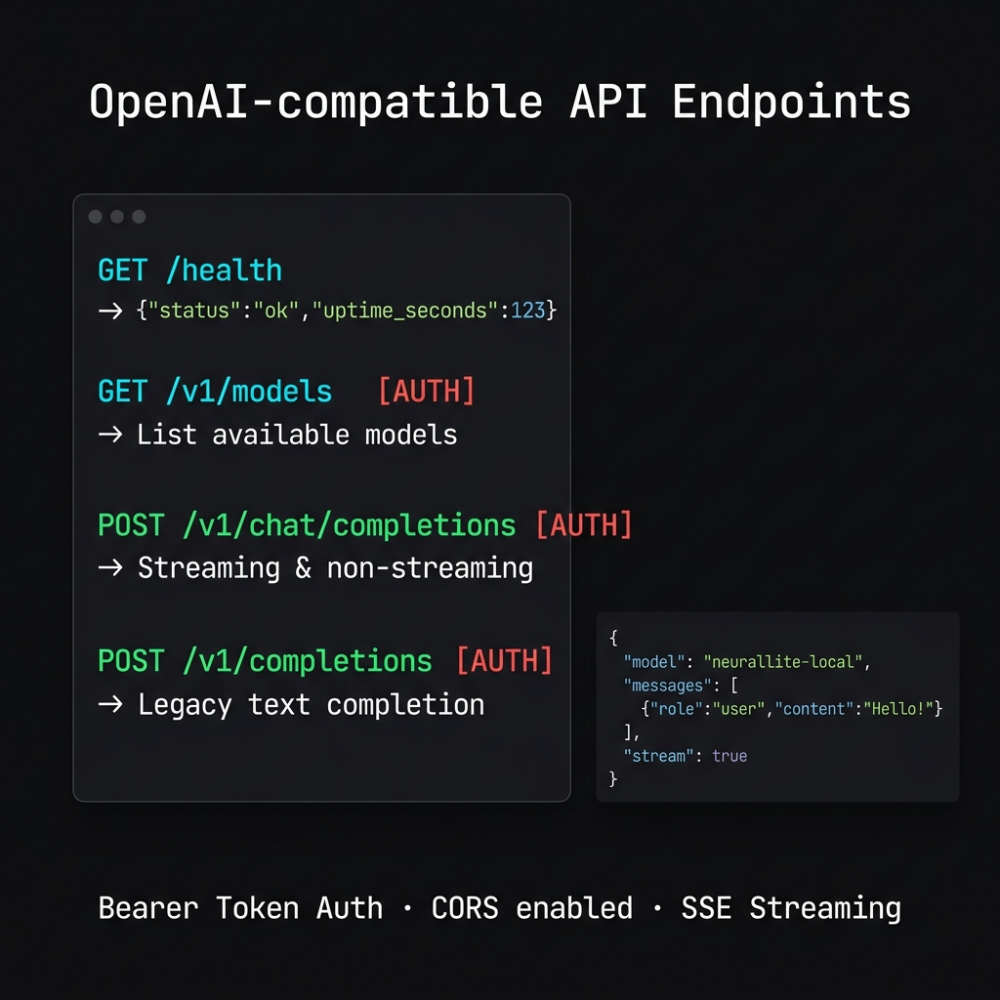

<div align="center">
  
  <h1>NeuralLite</h1>
  <p><strong>Turn your Android device into a private, local OpenAI-compatible AI inference server.</strong></p>
  <p>Run quantized GGUF models directly on-device via <code>llama.cpp</code> and serve standard REST &amp; SSE streaming APIs over your local Wi-Fi network — zero cloud dependency, zero API fees, and zero telemetry leaving your device.</p>

  <br/>

  -3DDC84?logo=android&logoColor=white)
  
  
  
</div>

---

## Table of Contents

- [Overview](#overview)
- [Key Features](#key-features)
- [Architecture](#architecture)
- [Hardware Detection & Tier System](#hardware-detection--tier-system)
- [Model Catalog & Lifecycle](#model-catalog--lifecycle)
- [Local REST API Reference](#local-rest-api-reference)
- [App Screens](#app-screens)
- [Security & Backup Protection](#security--backup-protection)
- [Installation](#installation)
- [Requirements](#requirements)
- [Build & Test from Source](#build--test-from-source)
- [Tech Stack](#tech-stack)

---

## Overview

**NeuralLite** (`com.neurallite.app`) packages a native `llama.cpp` inference engine (`libllama_android.so`) inside an Android Foreground Service and exposes an **OpenAI-compatible HTTP server** (`NanoHTTPD`) on your local network (default port `8080`).

Any tool that speaks the OpenAI protocol — `curl`, the official Python/JS `openai` SDKs, Open WebUI, or LangChain — can target your phone's LAN IP and receive non-streaming completions or real-time Server-Sent Events (SSE) token streams.

---

## Key Features

| Capability | Details |
|---|---|
| **OpenAI-Compatible REST API** | `GET /health`, `GET /v1/models`, `GET /v1/models/neurallite-local`, `POST /v1/chat/completions`, `POST /v1/completions`, and `OPTIONS *` |
| **SSE Streaming & Disconnect Abort** | Non-gzipped `text/event-stream` chunked responses with `finish_reason`, optional `stream_options.include_usage`, and immediate inference cancellation if the client drops the socket |
| **Native `llama.cpp` (`b3248`) JNI Engine** | CPU-optimized `libllama_android.so` with `EngineCoordinator` mutex serialization, UTF-8 `ByteArray` JNI transport, chunked prompt batching (`<= 512` tokens/step), and `n_ctx` overflow protection |
| **Model-Aware Chat Templates** | Automatic formatting and stop-sequence filtering for `ZEPHYR`, `PHI2`, `GEMMA`, `MISTRAL_V1`, and `LLAMA3` (including OpenAI `developer` role mapping and content-part arrays) |
| **Hardware Detection & Tiering** | Reads total/available RAM, CPU cores, ABI, free storage, API level, and offscreen EGL GPU renderer; classifies devices into Tiers 1–4 and caches the profile |
| **Curated GGUF Model Manager** | Wi-Fi `DownloadManager` downloads with live progress, pause notes, cancellation, GGUF header/size validation, sequential model switching, unload, and per-model or bulk deletion |
| **Persistent Foreground Server** | `dataSync` foreground service with configurable Port, CORS, mDNS (`_neurallite._tcp.`), Wi-Fi High-Perf lock, Partial Wake Lock, and ongoing notification with Stop action |
| **Encrypted Bearer Auth** | Auto-generated UUID v4 token stored in `EncryptedSharedPreferences` (`AES256_SIV` / `AES256_GCM`), excluded from cloud backups, with live in-place token rotation |
| **4-Tab Dark Neon Compose UI** | Material 3 UI (`Detect`, `Models`, `Server`, `Config`) with persisted settings, real LAN IP display, live request/throughput counters, and a rolling 50-entry color-coded request log |

---

## Architecture

<div align="center">
  
</div>

```text
NeuralLite/
├── app/
│   ├── build.gradle.kts                      # AGP 8.4 / Kotlin 2.0 / Compose / CMake 3.22.1
│   ├── proguard-rules.pro                    # Keeps LlamaEngine native methods & TokenCallback
│   └── src/
│       ├── main/
│       │   ├── AndroidManifest.xml           # Permissions, MainActivity, dataSync service, backup rules
│       │   ├── cpp/
│       │   │   ├── CMakeLists.txt            # Compiles libllama_android.so (-O3, CPU-only)
│       │   │   ├── llama_bridge.cpp          # UTF-8 byte JNI bridge, chunked decode, stop_flag
│       │   │   └── llama/                    # Vendored llama.cpp (tag b3248) sources
│       │   ├── java/com/neurallite/app/
│       │   │   ├── NeuralliteApp.kt          # Lightweight Application entry point
│       │   │   ├── MainActivity.kt           # Dark edge-to-edge Scaffold & 4-tab NavHost
│       │   │   ├── engine/LlamaEngine.kt     # EngineCoordinator (Mutex + AtomicLong + JNI)
│       │   │   ├── hardware/HardwareScanner.kt # EGL GPU, RAM/CPU/Storage scan & Tier 1-4
│       │   │   ├── models/
│       │   │   │   ├── ModelCatalog.kt       # 5 GGUF entries + PromptTemplate definitions
│       │   │   │   └── ModelManager.kt       # DownloadManager, GGUF checks, load/switch/delete
│       │   │   ├── server/
│       │   │   │   ├── ServerEvent.kt        # RequestReceived, RequestCompleted, Lifecycle events
│       │   │   │   ├── NeuralliteServer.kt   # NanoHTTPD router, UTF-8/chunked body, SSE pipe
│       │   │   │   └── NeuralliteServerService.kt # Foreground service, NSD, locks, TokenStore
│       │   │   ├── ui/                       # Dark Neon theme, components & 4 screen composables
│       │   │   └── viewmodel/NeuralliteViewModel.kt # Persisted Config & reactive StateFlows
│       │   └── res/xml/                      # backup_rules.xml & data_extraction_rules.xml
│       ├── test/                             # 56 JVM unit tests (Engine, Hardware, Catalog, Server)
│       └── androidTest/                      # Compose UI, service, and Config persistence tests
├── payload.json                              # Sample chat completion request payload
└── NeuralLite.apk                            # Pre-built ARM64 release APK
```

### Key Runtime Guarantees

- **Serialized Inference Context:** `EngineCoordinator` guards model loading, unloading, and inference with a Kotlin `Mutex` and generation/handle barriers so parallel HTTP requests queue safely over the single native `llama_context`.
- **Safe JNI String & Context Handling:** Prompts and streamed token chunks cross JNI as raw UTF-8 `ByteArray`s, preventing Modified UTF-8 / CESU-8 corruption and ART `NewStringUTF` crashes on emojis. Prompt decoding is chunked (`<= 512` tokens per `llama_decode`) and bounded by `n_ctx`.
- **Correct HTTP/1.1 Keep-Alive & Chunked Framing:** `NeuralliteServer` reads `UTF-8` bodies directly (supporting both `Content-Length` and `Transfer-Encoding: chunked`), disables GZIP on `text/event-stream`, and drains or closes unread bodies on `400`/`401`/`503` responses so persistent connections never desync.

---

## Hardware Detection & Tier System

Tap **Run Hardware Scan** on the **Detect** tab to evaluate your device (`HardwareScanner` runs on `Dispatchers.IO`, detects the GPU via an offscreen `EGL10`/`GLES10` context, and caches the `HardwareProfile` in `SharedPreferences("neurallite_hardware")` for instant startup restoration):

| Tier | Label | Criteria (`1 GB = 1,073,741,824 B`) | Recommended Models |
|---|---|---|---|
| **Tier 1** | Flagship | `totalRAM >= 8 GB` AND `cpuCores >= 8` | Llama 3 8B, Mistral 7B |
| **Tier 2** | Mid-range | `totalRAM >= 4 GB` AND `cpuCores >= 6` | Mistral 7B, Gemma 2B IT, Phi-2 2.7B |
| **Tier 3** | Entry | `totalRAM >= 3 GB` AND `cpuCores >= 4` | TinyLlama 1.1B, Gemma 2B IT, Phi-2 2.7B |
| **Tier 4** | Minimal | Below Tier 3 thresholds | TinyLlama 1.1B |

---

## Model Catalog & Lifecycle

Models are downloaded from HuggingFace in GGUF format over unmetered Wi-Fi (`setAllowedOverMetered(false)`, `setAllowedOverRoaming(false)`) into `getExternalFilesDir("models")`:

| ID | Display Name | Size | RAM Req | Est. Speed | Tiers | Context | Template |
|---|---|---|---|---|---|---|---|
| `tinyllama_1b_q8` | **TinyLlama 1.1B** (`Q8_0`) | 1.1 GB | 1.5 GB | ~25 tok/s | 4, 3 | 2048 | `ZEPHYR` |
| `phi2_q4km` | **Phi-2 2.7B** (`Q4_K_M`) | 1.6 GB | 3.0 GB | ~12 tok/s | 3, 2 | 2048 | `PHI2` |
| `gemma2b_q4ks` | **Gemma 2B IT** (`Q4_K_S`) | 1.3 GB | 2.5 GB | ~15 tok/s | 3, 2 | 4096 | `GEMMA` |
| `mistral7b_q3km` | **Mistral 7B Instruct** (`Q3_K_M`) | 3.1 GB | 5.5 GB | ~6 tok/s | 1, 2 | 8192 | `MISTRAL_V1` |
| `llama3_8b_q4km` | **Llama 3 8B Instruct** (`Q4_K_M`) | 4.9 GB | 7.0 GB | ~5 tok/s | 1 | 8192 | `LLAMA3` |

`ModelManager` reconciles active, failed, and completed `DownloadManager` entries on startup, verifies the `GGUF` magic header and byte length, supports cancelling in-flight downloads, unloading active models, sequential model switching, and deleting individual or all models.

---

## Local REST API Reference

<div align="center">
  
</div>

### Authentication & Headers

- `GET /health` and `OPTIONS *` require **no** authentication.
- All `/v1/*` routes require `Authorization: Bearer <token>` (case-insensitive `Bearer` scheme); invalid or missing tokens return `401 Unauthorized` (`{"error":"unauthorized"}`).
- When **CORS Headers** is enabled in **Config**, responses include:
  - `Access-Control-Allow-Origin: *`
  - `Access-Control-Allow-Methods: GET,POST,OPTIONS`
  - `Access-Control-Allow-Headers: Authorization,Content-Type`

### Endpoints

| Method & Path | Auth | Behavior |
|---|---|---|
| `GET /health` | No | Returns `status` (`"ok"`), `model` (native JSON metadata or `null`), and `uptime_seconds` |
| `GET /v1/models` | Bearer | Returns OpenAI model list containing `"neurallite-local"` |
| `GET /v1/models/neurallite-local` | Bearer | Returns metadata object for `"neurallite-local"` |
| `POST /v1/chat/completions` | Bearer | Accepts `messages` (`role`, string or `[{"type":"text","text":...}]` `content`), `max_tokens` / `max_completion_tokens`, `temperature`, `stop` (string or array), `stream` (`true`/`false`), and `stream_options.include_usage`. Returns `503` if no model is loaded, `400` on invalid payloads or prompt `context_overflow`, and real `usage` token counts. |
| `POST /v1/completions` | Bearer | Legacy text completion supporting `prompt` (string or non-empty string array), `max_tokens` / `max_completion_tokens`, `temperature`, `stop`, `stream` (`true`/`false`), and `stream_options.include_usage`. |
| `OPTIONS *` | No | CORS preflight responder (`200 OK`) |

### Client Examples

#### `curl` via ADB Port Forwarding

```bash
adb forward tcp:8080 tcp:8080
curl http://localhost:8080/health
curl http://localhost:8080/v1/chat/completions \
  -H "Authorization: Bearer <your-token>" \
  -H "Content-Type: application/json" \
  -d @payload.json
```

#### Python `openai` SDK (Over Wi-Fi LAN)

```python
from openai import OpenAI

client = OpenAI(
    base_url="http://<phone-lan-ip>:8080/v1",
    api_key="<token-from-server-screen>",
)

stream = client.chat.completions.create(
    model="neurallite-local",
    messages=[
        {"role": "system", "content": "You are concise."},
        {"role": "user", "content": "Explain quantization in two sentences."},
    ],
    temperature=0.7,
    max_tokens=256,
    stream=True,
)

for chunk in stream:
    print(chunk.choices[0].delta.content or "", end="", flush=True)
```

#### Open WebUI & LangChain

- **Open WebUI:** **Settings -> Connections -> OpenAI API** -> URL `http://<phone-lan-ip>:8080/v1`, API Key `<your-token>`, model `neurallite-local`.
- **LangChain:** Initialize `ChatOpenAI(base_url="http://<phone-lan-ip>:8080/v1", api_key="<your-token>", model="neurallite-local")`.

---

## App Screens

1. **Detect:** One-tap animated radar scan, color-coded Hardware Tier card (`Tier 1`–`Tier 4`), equal-height 2x2 metric grid (`Total RAM`, `CPU Cores`, `GPU`, `Free Storage`), **Model Capability Range** bar, and device details (`ABI`, `API Level`, `Available RAM`).
2. **Models:** Reactive storage bar (`GB used · GB free`), scan prompt when hardware hasn't been scanned yet, dismissible engine error banner, tier-sorted catalog cards with **Best Match** and non-blocking **Insufficient RAM** chips, and full download/cancel/load/unload/switch/delete controls.
3. **Server:** Pulsing Start/Stop button (prompts for `POST_NOTIFICATIONS` on Android 13+), active model status, conditional **Stop Active Inference** control during generation, tap-to-copy `Local` and real `LAN` endpoint URLs, masked/copyable/regenerable Bearer API token, cumulative `Requests` and `Avg tok/s` metrics, and a rolling 50-entry color-coded **Request Log** (`HH:mm:ss · METHOD /path · STATUS · XXms`) with **Clear**.
4. **Config:** Persisted **Inference** (`Context Window`, `CPU Threads`, `Temperature`, `Max Tokens`) and **Server** (`Port` `1024–65535`, `CORS Headers`, `mDNS / Bonjour`, `Wake Lock`) settings, pending reload/restart hints, **App Info**, and **Clear All Models** danger zone.

---

## Security & Backup Protection

- **Bearer Token Storage:** Tokens are generated via `UUID.randomUUID()` and stored in `EncryptedSharedPreferences` (`neurallite_secure_prefs`) using `MasterKey` (`AES256_GCM`) with `AES256_SIV` keys and `AES256_GCM` values, plus automatic recovery if keystore state mismatches occur.
- **Backup Exclusion:** `neurallite_secure_prefs.xml` is explicitly excluded in [backup_rules.xml](app/src/main/res/xml/backup_rules.xml) and [data_extraction_rules.xml](app/src/main/res/xml/data_extraction_rules.xml).
- **Live Rotation:** Tapping **Regenerate** on the **Server** tab updates the encrypted token and immediately rotates the active server's accepted credential without restarting the socket.
- **LAN Scope Warning:** When running, the server binds to `0.0.0.0`. Avoid running NeuralLite on untrusted public Wi-Fi networks.

---

## Installation

1. Sideload **[NeuralLite.apk](NeuralLite.apk)** onto an ARM64 Android device (`Android 8.0+` / API 26+, *"Install from unknown apps"* enabled). *(Note: the bundled `NeuralLite.apk` is signed with a debug certificate for sideloading/testing.)*
2. Open **NeuralLite** -> **Detect** -> tap the radar button to **Run Hardware Scan**.
3. Open **Models** -> download a model suited to your tier -> tap **Load Model**.
4. Open **Server** -> tap **Start** (grant notification permission if prompted on Android 13+).
5. Copy the **LAN** URL and **API Token** into your client.

---

## Requirements

- **OS:** Android 8.0 (API 26) or higher (`targetSdk = 34`)
- **CPU ABI:** `arm64-v8a` for release builds (`debug` builds include both `arm64-v8a` and `x86_64`)
- **Storage:** 1.1 GB – 5+ GB free space depending on downloaded GGUF models
- **RAM:** 2+ GB minimum (1.5 GB – 7+ GB required depending on model; see catalog table)
- **Network:** Local Wi-Fi (or USB `adb forward`) for client access

---

## Build & Test from Source

Requires **JDK 17**, **Android SDK Platform 34**, **NDK**, and **CMake 3.22.1**.

```powershell
# Build debug APK (arm64-v8a + x86_64)
.\gradlew.bat assembleDebug

# Build release APK (arm64-v8a)
.\gradlew.bat assembleRelease

# Run JVM unit tests (56 tests across Engine, Hardware, Catalog, ModelManager, Server)
.\gradlew.bat testDebugUnitTest

# Run Android instrumented UI & service tests (requires attached device/emulator)
.\gradlew.bat connectedDebugAndroidTest

# Run Android Lint
.\gradlew.bat lintDebug
```

---

## Tech Stack

| Layer | Technology |
|---|---|
| **UI** | Jetpack Compose · Material 3 · Navigation Compose |
| **Architecture** | MVVM · Coroutines · `StateFlow` / `SharedFlow` |
| **HTTP Server** | NanoHTTPD `2.3.1` |
| **Native Inference** | `llama.cpp` (`tag b3248`) via JNI (`libllama_android.so`) |
| **Security** | AndroidX Security `security-crypto` (`EncryptedSharedPreferences`) |
| **Discovery & Background** | Android NSD (`_neurallite._tcp.`) · `dataSync` Foreground Service · `DownloadManager` |
| **Build** | Gradle `8.7` · AGP `8.4.0` · Kotlin `2.0.0` · CMake `3.22.1` |
